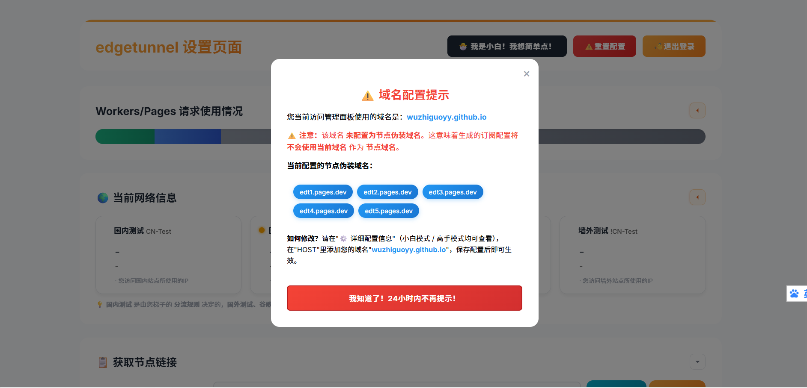
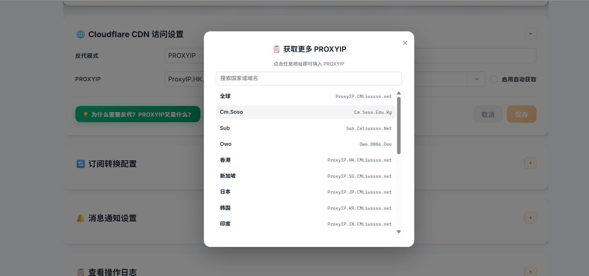
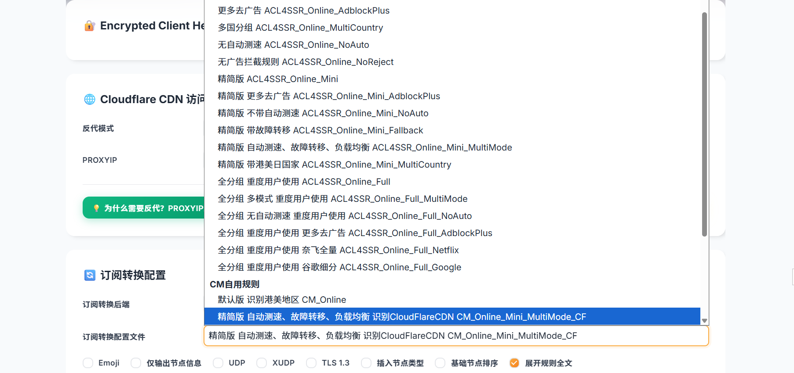

# edgetunnel Admin Panel (EDT-Pages Template)

A static **admin panel** for [edgetunnel](https://github.com/cmliu/edgetunnel) on Cloudflare Workers. Pure HTML/CSS/JS — host it on GitHub Pages, Cloudflare Pages, or any static server.

**Languages**: [English](README.en.md) · [日本語](README.ja.md) · [한국어](README.ko.md) · [Français](README.fr.md) · [简体中文](README.md)

> ⚠️ **For overseas users and overseas business scenarios only.** Use in mainland China must comply with the Cybersecurity Law of the PRC and related regulations. See [Compliance](#compliance-notice) below.

> This repository is a deployment copy of [EDT-Pages/EDT-Pages.github.io](https://github.com/EDT-Pages/EDT-Pages.github.io), with small modifications (see [Changes in this repo](#changes-in-this-repo)).

**Keywords**: edgetunnel, Cloudflare Workers, Cloudflare Pages, PROXYIP, ProxyIP, VLESS, VMess, Trojan, WebSocket, TLS, Clash, Clash Verge, mihomo, v2rayN, v2rayNG, Shadowrocket, Streisand, subscription, proxy admin panel, edge tunnel, cloudflare proxy, vless ws tls.

---

## Screenshots







---

## Features

- Log in and edit Worker configuration online (UUID, protocol, path, preferred IPs, etc.)
- Visual configuration for PROXYIP / SOCKS5 / HTTP / HTTPS reverse proxy
- Built-in PROXYIP presets, selectable by country
- **📋 More PROXYIP** dialog with search and one-click fill
- Generate node links, subscription links, and QR codes
- Worker request usage, GitHub version check, latency test

---

## Compliance Notice

### Intended users

This project is a **configuration panel template**, intended only for:

- Overseas companies and teams managing internal networks;
- Overseas individuals for study, research, and technical validation;
- Licensed network service providers outside mainland China.

### Mainland China

Using unauthorized channels for international networking in mainland China violates applicable laws and regulations, including the Cybersecurity Law of the PRC and the Provisional Regulations on the Management of Computer Information Networks' International Networking.

Therefore:

1. This project does **not** provide any network service to users in mainland China;
2. Do **not** use this project for international proxy access inside mainland China;
3. For cross-border connectivity in mainland China, use licensed carriers or dedicated lines;
4. Enterprises should complete legal and compliance review before internal use.

### Disclaimer

- This project only provides **technical templates and sample code**; it does not provide network access services or operate any nodes;
- Users are responsible for ensuring their use complies with local laws;
- The authors are not liable for any direct or indirect damages.

---

## Directory structure

```
.
├── admin/
│   ├── index.html          # main admin page
│   ├── config.json         # config template
│   ├── ADD.txt             # custom preferred IPs
│   ├── log.json            # log placeholder
│   ├── check               # proxy check placeholder
│   ├── getADDAPI           # preferred-IP API placeholder
│   └── getCloudflareUsage  # usage query placeholder
├── login/index.html        # login page
├── noADMIN/index.html      # shown when no password is set
├── noKV/index.html         # shown when KV is not bound
├── index.html              # site landing page
├── version                 # version file
├── locations               # region list
├── sub                     # subscription placeholder
├── cdn-cgi/trace           # trace placeholder
└── image/                  # QR code and screenshots
```

> `admin/config.json`, `log.json`, etc. are **placeholders only**. At runtime the Worker serves these endpoints from its own storage.

Large files (Worker source zip, v2rayN client) are attached to [Releases](../../releases/latest), not stored in the repo.

---

## Deploy: GitHub Pages

1. Create a **Public** repository;
2. Upload all files to the repository root;
3. **Settings → Pages**:
   - Source: `Deploy from a branch`
   - Branch: `main`, folder `/ (root)`
   - Save
4. Wait 1–2 minutes, then open `https://<user>.github.io/<repo>`.

### User site vs project site

| Type | Repo name | URL | Notes |
| --- | --- | --- | --- |
| User site | `<user>.github.io` | `https://<user>.github.io` | Served at root |
| Project site | any | `https://<user>.github.io/<repo>` | Served in a subdirectory |

Project sites need the path patch: `admin/index.html` already rewrites `/admin/xxx` requests to the deployment prefix, avoiding `config.json 404`.

---

## Deploy: Cloudflare Pages

1. Cloudflare → Workers & Pages → Create → Pages;
2. Connect Git or upload the ZIP directly;
3. No build command; output directory `/`;
4. Result: `https://<project>.pages.dev`.

---

## Connect to the Worker

In `_worker.js`, change the first constant:

```js
const Pages静态页面 = 'https://<user>.github.io/<repo>'
```

Do **not** append a trailing slash or `/admin`. Redeploy the Worker, then open:

```
https://<worker-domain>/admin
```

---

## Worker source package

Download `edgetunnel-main.zip` from [Releases](../../releases/latest). It contains:

```
edgetunnel-main/
├── _worker.js
├── wrangler.toml
└── README.md
```

Deploy options:

- **Web editor**: Cloudflare → Worker → Edit code → paste the whole `_worker.js` → Deploy;
- **wrangler**: `npx wrangler deploy` inside the extracted folder.

> Do not pack your UUID, API tokens, or passwords into a public package.

---

## Usage

1. Open `https://<worker-domain>/admin` and log in;
2. Adjust protocol, UUID, PATH, preferred IPs;
3. Under **Cloudflare CDN settings**, choose reverse-proxy mode `PROXYIP` and pick an address (or use **More PROXYIP**);
4. Save;
5. Copy the node or subscription link into your client.

### Clients

| Platform | Client |
| --- | --- |
| Windows | v2rayN, Clash Verge, mihomo |
| Android | v2rayNG, Clash Meta for Android |
| iOS | Shadowrocket, Stash, Streisand, V2Box |
| macOS | ClashX, Stash, sing-box |

### Verify

- Open `https://ipinfo.io/json` — should show a foreign IP;
- Run a latency test in the client;
- Open Google / YouTube.

---

## FAQ

### Broken layout / missing settings

Usually caused by deploying in a subdirectory without the path patch. Check the browser console for `/admin/config.json 404`.

### Redirected back to login

Check the Worker `ADMIN` variable, cookies, and that you are visiting the Worker domain.

### `record with that host already exists`

Delete the existing A/AAAA/CNAME record for that hostname in Cloudflare DNS, then add the custom domain again.

### Opening GitHub Pages directly shows no config

Expected. `config.json` and other endpoints are served by the Worker.

---

## Changes in this repo

- `admin/index.html`: added the **📋 More PROXYIP** button and dialog;
- `admin/index.html`: added a subdirectory deployment path patch;
- PROXYIP presets trimmed to upstream-verified addresses plus custom ones;
- README translated into English and Japanese.

---

## Contact

Scan the QR code for deployment questions:


Please include: which step failed, the browser console or Worker log, and a screenshot with secrets masked.

> Technical support only. No network access service is provided.

---

## Credits

- [cmliu/edgetunnel](https://github.com/cmliu/edgetunnel)
- [EDT-Pages/EDT-Pages.github.io](https://github.com/EDT-Pages/EDT-Pages.github.io)
- [CMLiussss](https://github.com/cmliu)

## License

Follows the upstream license. Keep the original attribution; do not use for illegal purposes.
