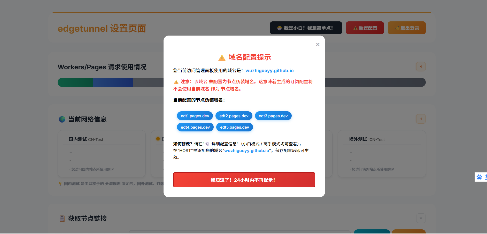
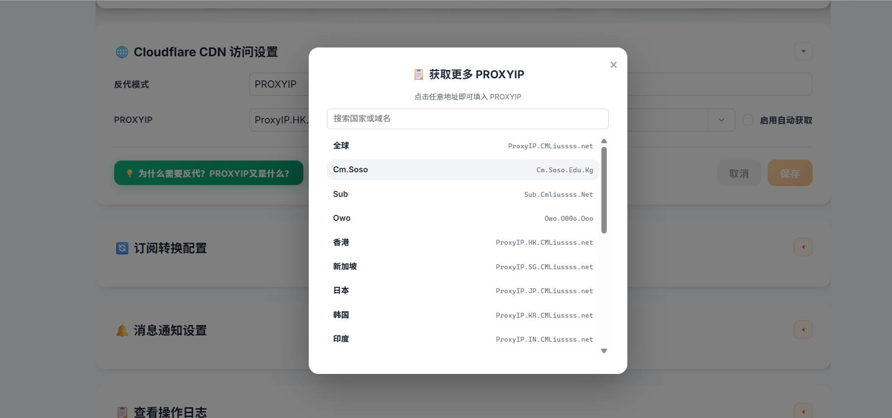
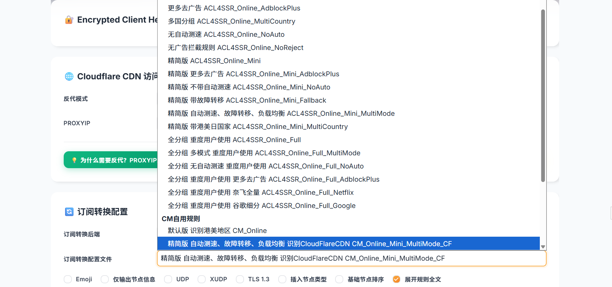

# Panneau d'administration edgetunnel (modèle EDT-Pages)

**Panneau d'administration** statique pour [edgetunnel](https://github.com/cmliu/edgetunnel) sur Cloudflare Workers. Fichiers HTML/CSS/JS uniquement — hébergez-le sur GitHub Pages, Cloudflare Pages ou tout serveur statique.

**Langues** : [简体中文](README.md) · [English](README.en.md) · [日本語](README.ja.md) · [한국어](README.ko.md) · [Français](README.fr.md)

> ⚠️ **Destiné uniquement aux utilisateurs et aux activités hors de Chine continentale.** Toute utilisation en Chine continentale doit respecter la loi sur la cybersécurité et les réglementations associées. Voir [« Conformité »](#conformité) ci-dessous.

> Ce dépôt est une copie de déploiement de [EDT-Pages/EDT-Pages.github.io](https://github.com/EDT-Pages/EDT-Pages.github.io), avec quelques modifications (voir [« Modifications de ce dépôt »](#modifications-de-ce-dépôt)).

**Mots-clés** : edgetunnel, Cloudflare Workers, Cloudflare Pages, PROXYIP, ProxyIP, VLESS, VMess, Trojan, WebSocket, TLS, Clash, Clash Verge, mihomo, v2rayN, v2rayNG, Shadowrocket, Streisand, abonnement, panneau d'administration, proxy, edge tunnel, cloudflare proxy, vless ws tls.

---

## Captures d'écran







---

## Fonctionnalités

- Connexion et modification de la configuration du Worker en ligne (UUID, protocole, chemin, IP préférées, etc.)
- Configuration visuelle des proxies inverses PROXYIP / SOCKS5 / HTTP / HTTPS
- Préréglages PROXYIP intégrés, sélectionnables par pays
- Boîte de dialogue **📋 Plus de PROXYIP** avec recherche et remplissage en un clic
- Génération des liens de nœud, des liens d'abonnement et des QR codes
- Suivi des requêtes du Worker, vérification de version GitHub, test de latence

---

## Conformité

### Public visé

Ce projet est un **modèle de panneau de configuration**, destiné uniquement :

- aux entreprises et équipes hors de Chine continentale gérant leur réseau interne ;
- aux particuliers hors de Chine continentale, pour l'étude et la validation technique ;
- aux fournisseurs de services disposant des autorisations locales.

### Chine continentale

En Chine continentale, l'utilisation de canaux non autorisés pour l'accès international enfreint la réglementation applicable, notamment la loi sur la cybersécurité et les règlements provisoires sur la gestion de l'interconnexion des réseaux d'information.

Par conséquent :

1. Ce projet ne fournit **aucun service réseau** aux utilisateurs de Chine continentale ;
2. N'utilisez pas ce projet comme proxy international en Chine continentale ;
3. Pour une connectivité transfrontalière, utilisez un opérateur agréé ou une ligne dédiée ;
4. Les entreprises doivent faire valider l'usage par leur service juridique.

### Avis de non-responsabilité

- Ce projet fournit uniquement des **modèles techniques et du code d'exemple** ; il ne fournit aucun service d'accès réseau et n'exploite aucun nœud ;
- L'utilisateur est responsable de la conformité de son usage avec la législation locale ;
- Les auteurs ne sauraient être tenus responsables des dommages directs ou indirects.

---

## Arborescence

```
.
├── admin/
│   ├── index.html          # page d'administration
│   ├── config.json         # modèle de configuration
│   ├── ADD.txt             # IP préférées personnalisées
│   ├── log.json            # journal (espace réservé)
│   ├── check               # vérification de proxy
│   ├── getADDAPI           # API des IP préférées
│   └── getCloudflareUsage  # requête d'utilisation
├── login/index.html        # page de connexion
├── noADMIN/index.html      # affiché sans mot de passe
├── noKV/index.html         # affiché sans KV
├── index.html              # page d'accueil
├── version                 # version
├── locations               # liste des régions
├── sub                     # abonnement (espace réservé)
├── cdn-cgi/trace           # trace (espace réservé)
└── image/                  # QR code et captures
```

> `admin/config.json`, `log.json`, etc. ne sont que des **espaces réservés**. À l'exécution, le Worker sert ces points d'accès depuis son propre stockage.

Les fichiers volumineux (zip du Worker, client v2rayN) sont joints aux [Releases](../../releases/latest).

---

## Déploiement : GitHub Pages

1. Créez un dépôt **Public** ;
2. Téléversez tous les fichiers à la racine du dépôt ;
3. **Settings → Pages** :
   - Source : `Deploy from a branch`
   - Branche : `main`, dossier `/ (root)`
   - Save
4. Après 1 à 2 minutes, ouvrez `https://<utilisateur>.github.io/<dépôt>`.

### Site utilisateur ou site de projet

| Type | Nom du dépôt | URL | Remarque |
| --- | --- | --- | --- |
| Site utilisateur | `<user>.github.io` | `https://<user>.github.io` | servi à la racine |
| Site de projet | libre | `https://<user>.github.io/<repo>` | servi dans un sous-dossier |

Les sites de projet nécessitent le correctif de chemin : `admin/index.html` réécrit les requêtes `/admin/xxx` vers le préfixe de déploiement, évitant le `config.json 404`.

---

## Déploiement : Cloudflare Pages

1. Cloudflare → Workers & Pages → Create → Pages ;
2. Connexion Git ou téléversement du ZIP ;
3. Aucune commande de build, répertoire de sortie `/` ;
4. URL obtenue : `https://<projet>.pages.dev`.

---

## Connexion au Worker

Dans `_worker.js`, modifiez la première constante :

```js
const Pages静态页面 = 'https://<user>.github.io/<repo>'
```

N'ajoutez **ni slash final ni `/admin`**. Redéployez le Worker, puis ouvrez :

```
https://<domaine-worker>/admin
```

---

## Paquet source du Worker

Téléchargez `edgetunnel-main.zip` depuis les [Releases](../../releases/latest).

```
edgetunnel-main/
├── _worker.js
├── wrangler.toml
└── README.md
```

Déploiement :

- **Éditeur web** : Cloudflare → Worker → Edit code → collez tout `_worker.js` → Deploy ;
- **wrangler** : `npx wrangler deploy` dans le dossier extrait.

> N'incluez jamais UUID, jetons d'API ou mots de passe dans un paquet public.

---

## Utilisation

1. Ouvrez `https://<domaine-worker>/admin` et connectez-vous ;
2. Réglez protocole, UUID, PATH, IP préférées ;
3. Dans **Cloudflare CDN**, choisissez le mode `PROXYIP` et une adresse (ou **Plus de PROXYIP**) ;
4. Enregistrez ;
5. Copiez le lien de nœud ou d'abonnement dans votre client.

### Clients

| Plateforme | Client |
| --- | --- |
| Windows | v2rayN, Clash Verge, mihomo |
| Android | v2rayNG, Clash Meta for Android |
| iOS | Shadowrocket, Stash, Streisand, V2Box |
| macOS | ClashX, Stash, sing-box |

### Vérification

- Ouvrez `https://ipinfo.io/json` : une IP étrangère doit apparaître ;
- Testez la latence dans le client ;
- Ouvrez Google / YouTube.

---

## FAQ

### Mise en page cassée / options manquantes

Souvent un déploiement en sous-dossier sans correctif de chemin. Vérifiez `/admin/config.json 404` dans la console.

### Retour à la page de connexion

Vérifiez la variable `ADMIN` du Worker, les cookies, et l'accès via le domaine du Worker.

### `record with that host already exists`

Supprimez l'enregistrement A/AAAA/CNAME existant dans Cloudflare DNS, puis ajoutez à nouveau le domaine personnalisé.

### Ouvrir GitHub Pages directement ne charge pas la configuration

C'est normal : `config.json` et les autres points d'accès sont servis par le Worker.

---

## Modifications de ce dépôt

- `admin/index.html` : ajout du bouton **📋 Plus de PROXYIP** et de sa boîte de dialogue ;
- `admin/index.html` : correctif de chemin pour un déploiement en sous-dossier ;
- Préréglages PROXYIP limités aux adresses vérifiées en amont et à quelques adresses personnalisées ;
- README traduit en anglais, japonais, coréen et français.

---

## Contact

En cas de problème de déploiement, scannez le QR code :


Merci d'indiquer : l'étape en échec, les erreurs de la console ou des journaux du Worker, et une capture d'écran (masquez UUID, jetons, mots de passe).

> Assistance technique uniquement. Aucun service d'accès réseau n'est fourni.

---

## Remerciements

- [cmliu/edgetunnel](https://github.com/cmliu/edgetunnel)
- [EDT-Pages/EDT-Pages.github.io](https://github.com/EDT-Pages/EDT-Pages.github.io)
- [CMLiussss](https://github.com/cmliu)

## Licence

Suit la licence amont. Conservez l'attribution originale ; toute utilisation illégale est interdite.
