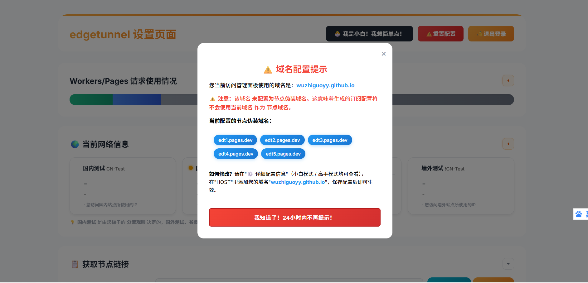
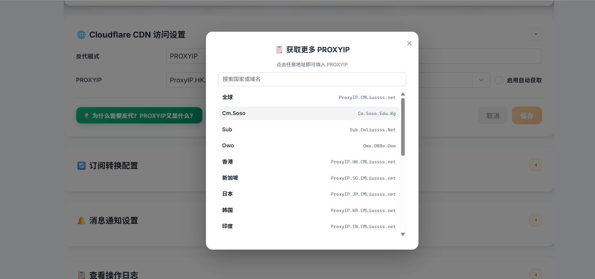
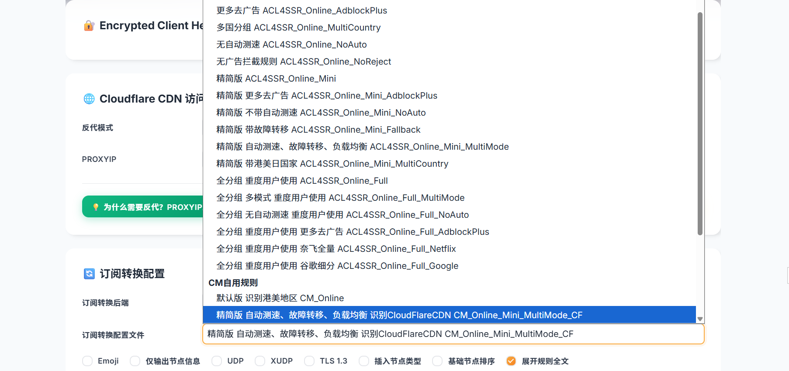

# edgetunnel 管理画面（EDT-Pages テンプレート）

Cloudflare Workers 版 [edgetunnel](https://github.com/cmliu/edgetunnel) の**管理画面（設定ページ）**です。静的ファイルのみで、GitHub Pages / Cloudflare Pages / 任意の静的サーバーに配置できます。

**言語**: [English](README.en.md) · [日本語](README.ja.md) · [한국어](README.ko.md) · [Français](README.fr.md) · [简体中文](README.md)

> ⚠️ **海外ユーザーおよび海外向け業務のみを対象としています。** 中国本土での利用は「サイバーセキュリティ法」等の法令を遵守してください。詳細は[「コンプライアンスについて」](#コンプライアンスについて)を参照してください。

> 本リポジトリは [EDT-Pages/EDT-Pages.github.io](https://github.com/EDT-Pages/EDT-Pages.github.io) の配置用コピーに小幅な変更を加えたものです（[本リポジトリでの変更点](#本リポジトリでの変更点)）。

**キーワード**: edgetunnel, Cloudflare Workers, Cloudflare Pages, PROXYIP, ProxyIP, VLESS, VMess, Trojan, WebSocket, TLS, Clash, Clash Verge, mihomo, v2rayN, v2rayNG, Shadowrocket, Streisand, サブスクリプション, 管理画面, プロキシ設定, edge tunnel, cloudflare proxy, vless ws tls.

---

## スクリーンショット







---

## 機能

- ログインして Worker の設定をオンラインで変更（UUID、プロトコル、パス、優先 IP など）
- PROXYIP / SOCKS5 / HTTP / HTTPS リバースプロキシを画面から設定
- 国別に選べる PROXYIP プリセット
- **📋 PROXYIP をさらに取得** ダイアログ（検索・ワンクリック入力）
- ノードリンク、サブスクリプションリンク、QR コードの生成
- Worker リクエスト数、GitHub バージョン確認、レイテンシーテスト

---

## コンプライアンスについて

### 対象利用者

本プロジェクトは**設定画面のテンプレート**であり、以下を対象とします。

- 海外企業・海外チームの内部ネットワーク管理
- 海外個人の学習・研究・技術検証
- 中国本土以外で適法な資格を持つサービス提供者

### 中国本土について

中国本土では、国際接続に関する法令（サイバーセキュリティ法、コンピュータ情報ネットワーク国際接続管理暫定規定など）により、未承認の回線による国際接続は違法とされています。

したがって:

1. 本プロジェクトは中国本土のユーザーに**ネットワークサービスを提供しません**;
2. 中国本土で本プロジェクトを国際プロキシとして使用しないでください;
3. 中国本土で越境通信が必要な場合は、認可された通信事業者または専用線を利用してください;
4. 企業内で利用する場合は、事前に法務・コンプライアンスの確認を行ってください。

### 免責事項

- 本プロジェクトは**技術テンプレートとサンプルコード**のみを提供し、ネットワーク接続サービスやノードの運用は行いません;
- 利用者は、自身の利用が地域の法令に適合することを確認する責任を負います;
- 作者および貢献者は、直接的・間接的な損害について責任を負いません。

---

## ディレクトリ構成

```
.
├── admin/
│   ├── index.html          # 管理画面（メイン）
│   ├── config.json         # 設定テンプレート
│   ├── ADD.txt             # カスタム優先 IP
│   ├── log.json            # ログ用プレースホルダー
│   ├── check               # プロキシチェック用
│   ├── getADDAPI           # 優先 IP API 用
│   └── getCloudflareUsage  # 使用量取得用
├── login/index.html        # ログインページ
├── noADMIN/index.html      # パスワード未設定時
├── noKV/index.html         # KV 未バインド時
├── index.html              # サイトトップ
├── version                 # バージョン
├── locations               # 地域一覧
├── sub                     # サブスク用プレースホルダー
├── cdn-cgi/trace           # trace 用
└── image/                  # QR コード・スクリーンショット
```

> `admin/config.json` などは**プレースホルダー**です。実行時は Worker が自身のストレージから返します。

大きなファイル（Worker ソース zip、v2rayN クライアント）は [Releases](../../releases/latest) に添付しています。

---

## デプロイ：GitHub Pages

1. **Public** リポジトリを作成;
2. 全ファイルをリポジトリ直下にアップロード;
3. **Settings → Pages**:
   - Source: `Deploy from a branch`
   - Branch: `main`、フォルダ `/ (root)`
   - Save
4. 1〜2 分後に `https://<ユーザー>.github.io/<リポジトリ>` を開く。

### ユーザーサイトとプロジェクトサイト

| 種類 | リポジトリ名 | URL | 備考 |
| --- | --- | --- | --- |
| ユーザーサイト | `<user>.github.io` | `https://<user>.github.io` | ルート配信 |
| プロジェクトサイト | 任意 | `https://<user>.github.io/<repo>` | サブディレクトリ配信 |

プロジェクトサイトではパス補正が必要です。`admin/index.html` に `/admin/xxx` を配置先へ書き換える処理を入れてあるため、`config.json 404` は発生しません。

---

## デプロイ：Cloudflare Pages

1. Cloudflare → Workers & Pages → Create → Pages;
2. Git 連携または ZIP アップロード;
3. ビルドコマンドなし、出力ディレクトリ `/`;
4. `https://<project>.pages.dev` が発行されます。

---

## Worker との接続

`_worker.js` の先頭にある定数を変更します:

```js
const Pages静态页面 = 'https://<user>.github.io/<repo>'
```

末尾のスラッシュや `/admin` は**付けないでください**。Worker を再デプロイ後、次を開きます:

```
https://<worker-domain>/admin
```

---

## Worker ソースパッケージ

[Releases](../../releases/latest) から `edgetunnel-main.zip` をダウンロードしてください。

```
edgetunnel-main/
├── _worker.js
├── wrangler.toml
└── README.md
```

デプロイ方法:

- **Web エディタ**: Cloudflare → Worker → Edit code → `_worker.js` を貼り付け → Deploy;
- **wrangler**: 解凍したフォルダで `npx wrangler deploy`。

> 公開パッケージに UUID、API トークン、パスワードを含めないでください。

---

## 使い方

1. `https://<worker-domain>/admin` を開いてログイン;
2. プロトコル、UUID、PATH、優先 IP を設定;
3. **Cloudflare CDN 設定** でリバースプロキシモードを `PROXYIP` にし、アドレスを選択（**PROXYIP をさらに取得** も利用可）;
4. 保存;
5. ノードリンクまたはサブスクリプションリンクをクライアントに取り込みます。

### クライアント

| プラットフォーム | クライアント |
| --- | --- |
| Windows | v2rayN、Clash Verge、mihomo |
| Android | v2rayNG、Clash Meta for Android |
| iOS | Shadowrocket、Stash、Streisand、V2Box |
| macOS | ClashX、Stash、sing-box |

### 確認方法

- `https://ipinfo.io/json` を開き、海外 IP になっていること;
- クライアントでレイテンシーテスト;
- Google / YouTube が開けること。

---

## FAQ

### レイアウトが崩れる / 設定項目が消える

サブディレクトリ配置でパス補正が効いていない可能性があります。コンソールの `/admin/config.json 404` を確認してください。

### ログイン後にログイン画面へ戻る

Worker の `ADMIN` 変数、Cookie、Worker ドメイン経由でのアクセスを確認してください。

### `record with that host already exists`

Cloudflare DNS で同名の A/AAAA/CNAME レコードを削除してから、カスタムドメインを再追加してください。

### GitHub Pages を直接開くと設定が読めない

仕様です。`config.json` などは Worker が提供します。

---

## 本リポジトリでの変更点

- `admin/index.html`: 「📋 PROXYIP をさらに取得」ボタンとダイアログを追加;
- `admin/index.html`: サブディレクトリ配置用のパス補正を追加;
- PROXYIP プリセットを上流で確認できるアドレスとカスタムアドレスに整理;
- README を英語・日本語に翻訳。

---

## お問い合わせ

導入や設定で問題が発生した場合は、QR コードからご連絡ください:


お問い合わせ時に以下を添えてください:

1. どの手順で失敗したか;
2. ブラウザコンソールまたは Worker ログ;
3. スクリーンショット（UUID・トークン・パスワードはマスク）。

> 技術サポートのみです。ネットワーク接続サービスは提供しません。

---

## 謝辞

- [cmliu/edgetunnel](https://github.com/cmliu/edgetunnel)
- [EDT-Pages/EDT-Pages.github.io](https://github.com/EDT-Pages/EDT-Pages.github.io)
- [CMLiussss](https://github.com/cmliu)

## ライセンス

上流のライセンスに従います。原作者の表示を保持し、違法用途に使用しないでください。
