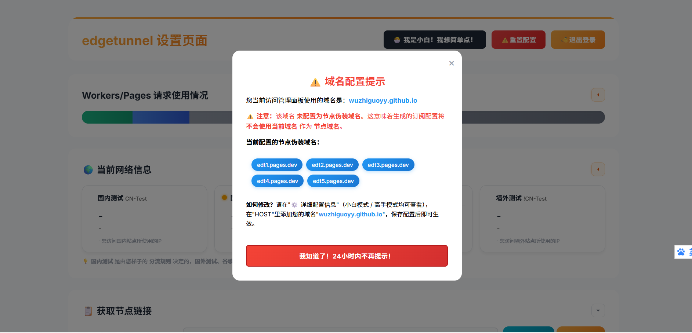
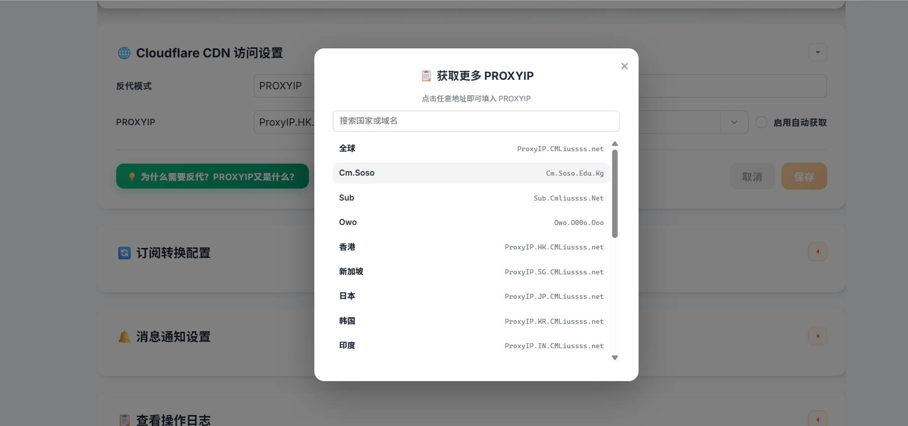
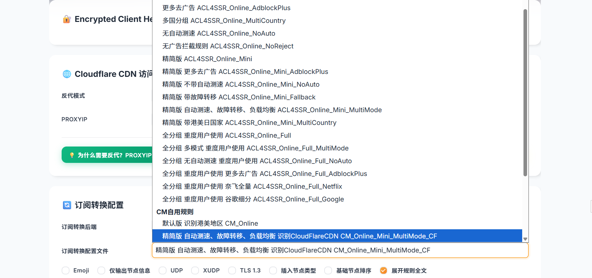

# edgetunnel 관리자 페이지 (EDT-Pages 템플릿)

Cloudflare Workers용 [edgetunnel](https://github.com/cmliu/edgetunnel)의 **관리자 설정 페이지**입니다. 순수 정적 파일이며 GitHub Pages, Cloudflare Pages 또는 임의의 정적 서버에 배포할 수 있습니다.

**언어**: [简体中文](README.md) · [English](README.en.md) · [日本語](README.ja.md) · [한국어](README.ko.md) · [Français](README.fr.md)

> ⚠️ **해외 사용자와 해외 업무 환경만을 대상으로 합니다.** 중국 본토에서 사용할 경우 「사이버보안법」 등 관련 법규를 준수해야 합니다. 자세한 내용은 [「컴플라이언스 안내」](#컴플라이언스-안내)를 참고하세요.

> 이 저장소는 [EDT-Pages/EDT-Pages.github.io](https://github.com/EDT-Pages/EDT-Pages.github.io)의 배포용 사본에 일부 수정을 가한 것입니다([이 저장소의 변경 사항](#이-저장소의-변경-사항)).

**키워드**: edgetunnel, Cloudflare Workers, Cloudflare Pages, PROXYIP, ProxyIP, VLESS, VMess, Trojan, WebSocket, TLS, Clash, Clash Verge, mihomo, v2rayN, v2rayNG, Shadowrocket, Streisand, 구독, 프록시 설정, 관리자 페이지, edge tunnel, cloudflare proxy, vless ws tls.

---

## 스크린샷







---

## 기능

- 로그인 후 Worker 설정을 온라인에서 변경 (UUID, 프로토콜, 경로, 우선 IP 등)
- PROXYIP / SOCKS5 / HTTP / HTTPS 리버스 프록시를 화면에서 설정
- 국가별로 선택 가능한 PROXYIP 프리셋
- **📋 PROXYIP 더 보기** 대화상자 (검색 + 원클릭 입력)
- 노드 링크, 구독 링크, QR 코드 생성
- Worker 요청 수, GitHub 버전 확인, 지연 시간 테스트

---

## 컴플라이언스 안내

### 대상 사용자

이 프로젝트는 **설정 페이지 템플릿**이며 다음을 대상으로 합니다.

- 해외 기업 및 해외 팀의 내부 네트워크 관리
- 해외 개인의 학습·연구·기술 검증
- 중국 본토 외 지역에서 적법한 자격을 갖춘 서비스 제공자

### 중국 본토

중국 본토에서는 국제 연결에 관한 법규(사이버보안법, 컴퓨터 정보 네트워크 국제 연결 관리 임시 규정 등)에 따라 승인되지 않은 회선을 통한 국제 연결은 위법입니다.

따라서:

1. 이 프로젝트는 중국 본토 사용자에게 **네트워크 서비스를 제공하지 않습니다**;
2. 중국 본토에서 이 프로젝트를 국제 프록시로 사용하지 마세요;
3. 중국 본토에서 국경 간 통신이 필요하면 허가된 통신사 또는 전용선을 이용하세요;
4. 기업 내부 사용 시 법무·컴플라이언스 검토를 먼저 완료하세요.

### 면책 조항

- 이 프로젝트는 **기술 템플릿과 예제 코드**만 제공하며 네트워크 접속 서비스나 노드를 운영하지 않습니다;
- 사용자는 자신의 사용이 현지 법규를 준수하도록 확인할 책임이 있습니다;
- 작성자와 기여자는 직간접적 손해에 대해 책임지지 않습니다.

---

## 디렉터리 구조

```
.
├── admin/
│   ├── index.html          # 관리자 메인 페이지
│   ├── config.json         # 설정 템플릿
│   ├── ADD.txt             # 사용자 지정 우선 IP
│   ├── log.json            # 로그 자리표시자
│   ├── check               # 프록시 검사
│   ├── getADDAPI           # 우선 IP API
│   └── getCloudflareUsage  # 사용량 조회
├── login/index.html        # 로그인 페이지
├── noADMIN/index.html      # 비밀번호 미설정 시
├── noKV/index.html         # KV 미바인딩 시
├── index.html              # 사이트 첫 페이지
├── version                 # 버전
├── locations               # 지역 목록
├── sub                     # 구독 자리표시자
├── cdn-cgi/trace           # trace 자리표시자
└── image/                  # QR 코드 및 스크린샷
```

> `admin/config.json` 등은 **자리표시자**입니다. 실행 시 Worker가 자체 저장소에서 응답합니다.

대용량 파일(Worker 소스 zip, v2rayN 클라이언트)은 [Releases](../../releases/latest)에 첨부되어 있습니다.

---

## 배포: GitHub Pages

1. **Public** 저장소 생성;
2. 모든 파일을 저장소 루트에 업로드;
3. **Settings → Pages**:
   - Source: `Deploy from a branch`
   - Branch: `main`, 폴더 `/ (root)`
   - Save
4. 1~2분 후 `https://<사용자>.github.io/<저장소>` 접속.

### 사용자 사이트 vs 프로젝트 사이트

| 유형 | 저장소 이름 | URL | 비고 |
| --- | --- | --- | --- |
| 사용자 사이트 | `<user>.github.io` | `https://<user>.github.io` | 루트 제공 |
| 프로젝트 사이트 | 임의 | `https://<user>.github.io/<repo>` | 하위 디렉터리 제공 |

프로젝트 사이트는 경로 보정이 필요합니다. `admin/index.html` 상단에 `/admin/xxx` 요청을 배포 경로로 바꾸는 코드가 있어 `config.json 404`가 발생하지 않습니다.

---

## 배포: Cloudflare Pages

1. Cloudflare → Workers & Pages → Create → Pages;
2. Git 연결 또는 ZIP 업로드;
3. 빌드 명령 없음, 출력 디렉터리 `/`;
4. `https://<project>.pages.dev` 발급.

---

## Worker 연결

`_worker.js` 첫 부분의 상수를 변경합니다:

```js
const Pages静态页面 = 'https://<user>.github.io/<repo>'
```

끝에 슬래시나 `/admin`을 붙이지 마세요. Worker를 다시 배포한 후 다음을 엽니다:

```
https://<worker-domain>/admin
```

---

## Worker 소스 패키지

[Releases](../../releases/latest)에서 `edgetunnel-main.zip`을 다운로드하세요.

```
edgetunnel-main/
├── _worker.js
├── wrangler.toml
└── README.md
```

배포 방법:

- **웹 편집기**: Cloudflare → Worker → Edit code → `_worker.js` 전체 붙여넣기 → Deploy;
- **wrangler**: 압축 해제 폴더에서 `npx wrangler deploy`.

> 공개 패키지에 UUID, API 토큰, 비밀번호를 포함하지 마세요.

---

## 사용 방법

1. `https://<worker-domain>/admin` 접속 후 로그인;
2. 프로토콜, UUID, PATH, 우선 IP 설정;
3. **Cloudflare CDN 설정**에서 리버스 프록시 모드를 `PROXYIP`으로 선택하고 주소 선택 (**PROXYIP 더 보기** 사용 가능);
4. 저장;
5. 노드 또는 구독 링크를 클라이언트에 가져오기.

### 클라이언트

| 플랫폼 | 클라이언트 |
| --- | --- |
| Windows | v2rayN, Clash Verge, mihomo |
| Android | v2rayNG, Clash Meta for Android |
| iOS | Shadowrocket, Stash, Streisand, V2Box |
| macOS | ClashX, Stash, sing-box |

### 확인

- `https://ipinfo.io/json` 접속 시 해외 IP 표시;
- 클라이언트에서 지연 시간 테스트;
- Google / YouTube 접속.

---

## FAQ

### 레이아웃이 깨지거나 설정 항목이 사라짐

하위 디렉터리 배포 시 경로 보정이 적용되지 않은 경우입니다. 콘솔의 `/admin/config.json 404`를 확인하세요.

### 로그인 후 다시 로그인 화면으로 돌아감

Worker의 `ADMIN` 변수, 쿠키, Worker 도메인을 통한 접속을 확인하세요.

### `record with that host already exists`

Cloudflare DNS에서 동일한 A/AAAA/CNAME 레코드를 삭제한 뒤 사용자 지정 도메인을 다시 추가하세요.

### GitHub Pages를 직접 열면 설정을 읽을 수 없음

정상입니다. `config.json` 등은 Worker가 제공합니다.

---

## 이 저장소의 변경 사항

- `admin/index.html`: **📋 PROXYIP 더 보기** 버튼과 대화상자 추가;
- `admin/index.html`: 하위 디렉터리 배포용 경로 보정 추가;
- PROXYIP 프리셋을 업스트림 확인 주소와 사용자 지정 주소로 정리;
- README를 영어·일본어·한국어·프랑스어로 번역.

---

## 문의

배포나 설정 중 문제가 있으면 QR 코드로 연락하세요:


문의 시 다음을 포함해 주세요:

1. 어느 단계에서 실패했는지;
2. 브라우저 콘솔 또는 Worker 로그;
3. 스크린샷(UUID·토큰·비밀번호는 가림 처리).

> 기술 지원만 제공하며 네트워크 접속 서비스는 제공하지 않습니다.

---

## 감사의 글

- [cmliu/edgetunnel](https://github.com/cmliu/edgetunnel)
- [EDT-Pages/EDT-Pages.github.io](https://github.com/EDT-Pages/EDT-Pages.github.io)
- [CMLiussss](https://github.com/cmliu)

## 라이선스

업스트림 라이선스를 따릅니다. 원저자 표시를 유지하고 불법 용도로 사용하지 마세요.
