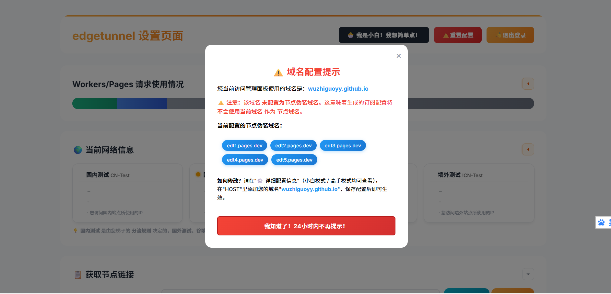
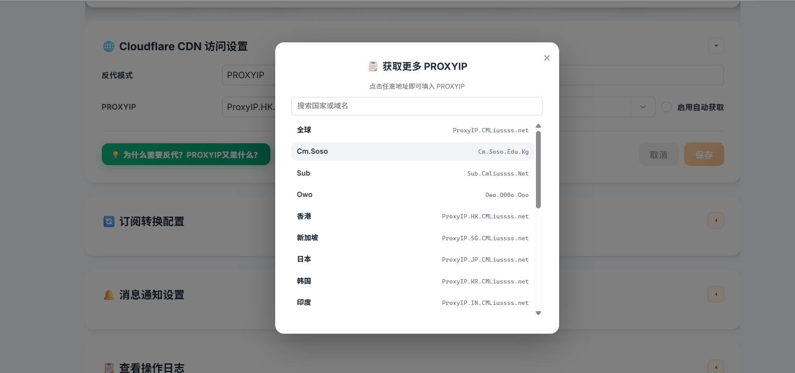
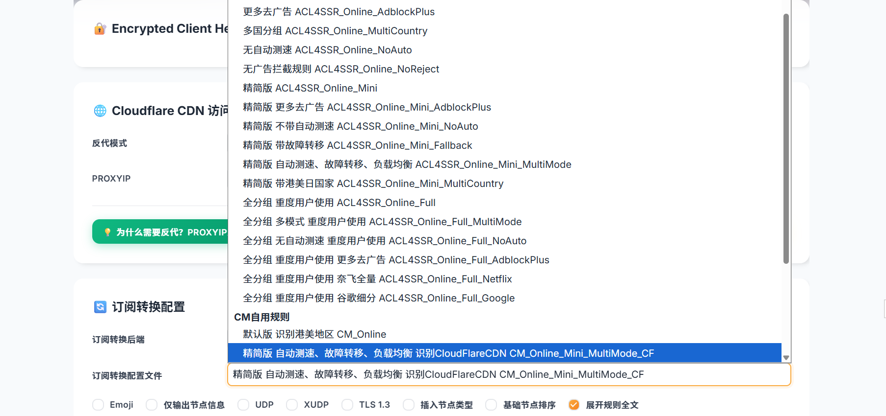

# edgetunnel 设置页面（EDT-Pages 模板）

Cloudflare Worker 版 [edgetunnel](https://github.com/cmliu/edgetunnel) 的**后台设置页面**，纯静态文件，可托管在 GitHub Pages、Cloudflare Pages 或任意静态服务器。

> ⚠️ **仅面向境外用户与境外业务场景。** 中国大陆境内使用须遵守《网络安全法》等法律法规，未经批准不得擅自建立或使用非法定信道进行国际联网。详见下方[「业务说明与合规提示」](#业务说明与合规提示)。

> 本仓库是 [EDT-Pages/EDT-Pages.github.io](https://github.com/EDT-Pages/EDT-Pages.github.io) 的部署副本，并按需做了少量修改（见「本仓库的改动」）。

**English**: A static admin panel template for [edgetunnel](https://github.com/cmliu/edgetunnel) on Cloudflare Workers. One-click PROXYIP selection, VLESS + WebSocket + TLS node generation, subscription links, and a full Chinese deployment guide.

**关键词 / Keywords**: edgetunnel, Cloudflare Workers, Cloudflare Pages, PROXYIP, ProxyIP, VLESS, VMess, Trojan, WebSocket, TLS, Clash, Clash Verge, mihomo, v2rayN, v2rayNG, Shadowrocket, Streisand, subscription, 订阅链接, 节点订阅, 代理设置页面, 科学上网, 翻墙, 机场面板, 优选IP, edge tunnel admin panel, cloudflare proxy, vless ws tls.

---

## 业务说明与合规提示

### 适用对象

本项目是一套**设置页面模板**，仅面向**境外用户与境外业务场景**：

- 海外企业、海外团队内部网络管理；
- 境外个人学习、研究与技术验证；
- 已取得当地合法资质的网络服务提供者。

### 关于中国大陆地区

中国大陆对国际联网有明确的法律法规要求，包括但不限于：

- 《中华人民共和国网络安全法》
- 《中华人民共和国计算机信息网络国际联网管理暂行规定》
- 《中华人民共和国电信条例》

**在中国大陆境内，未经主管部门批准，擅自建立、使用非法定信道进行国际联网属于违规行为**，可能面临行政处罚或其他法律后果。

因此：

1. 本项目**不面向中国大陆用户提供任何网络服务**；
2. 请勿在中国大陆境内将本项目用于任何形式的国际联网代理；
3. 如在中国大陆境内有跨境通信需求，请通过**依法取得资质的运营商或专线服务**办理；
4. 企业内部使用，应先完成法务与合规审批。

### 免责声明

- 本项目仅提供**技术模板与示例代码**，不提供网络接入服务、不运营任何节点；
- 使用者应自行确保其使用行为符合所在地法律法规；
- 因使用、修改、分发本项目产生的任何法律责任，由使用者自行承担；
- 作者与贡献者不对任何直接或间接损失负责。

### 合规建议

| 场景 | 建议 |
| --- | --- |
| 境外企业内部使用 | 走公司 IT/法务审批，限制访问范围 |
| 对外提供服务 | 取得当地 ISP/电信业务资质，完成备案 |
| 中国大陆境内 | 不使用本项目，改走合规专线 |
| 开源分发 | 保留本说明，不删除合规提示 |

---

## 功能

- 登录后台，在线修改 Worker 配置（UUID、协议、路径、优选 IP 等）
- 可视化配置 PROXYIP / SOCKS5 / HTTP / HTTPS 反代
- 内置常用 PROXYIP 下拉，支持按国家选择
- 「获取更多 PROXYIP」弹窗，可搜索并一键填入
- 修改后生成节点链接、订阅链接、二维码
- 显示 Worker 请求量、GitHub 版本检测、延迟测试等

---

## 界面预览

后台首页：



「获取更多 PROXYIP」弹窗，按国家搜索、一键填入：



详细配置与节点信息：



---

## 目录结构

```
.
├── admin/
│   ├── index.html          # 后台主页面（核心）
│   ├── config.json         # 配置模板
│   ├── ADD.txt             # 自定义优选 IP
│   ├── log.json            # 日志占位
│   ├── check               # 代理检查占位
│   ├── getADDAPI           # 优选 API 占位
│   └── getCloudflareUsage  # 用量查询占位
├── login/index.html        # 登录页
├── noADMIN/index.html      # 未设置密码时的提示页
├── noKV/index.html         # 未绑定 KV 时的提示页
├── index.html              # 站点首页
├── version                 # 版本号
├── locations               # 地区列表
├── sub                     # 订阅占位
├── cdn-cgi/trace           # trace 占位
└── image/联系二维码.jpg    # 联系作者二维码
```

> 大文件（Worker 源码包、v2rayN 客户端）不放在仓库里，统一放在 [Releases](../../releases/latest) 下载。

> `admin/` 下的 `config.json`、`log.json` 等只是**占位文件**。真正运行时，Worker 会用自己存储的配置覆盖这些接口，页面通过 `/admin/xxx` 读取。

---

## 部署方式一：GitHub Pages（推荐）

### 1. 建仓库

GitHub → New repository：

- 名称：任意，例如 `edt-pages`
- 可见性：**Public**

### 2. 上传文件

把本目录**全部内容**上传到仓库根目录（`admin/`、`login/`、`index.html` 等都要在根）。

### 3. 开启 Pages

仓库 → **Settings → Pages**：

- Source：`Deploy from a branch`
- Branch：`main`，目录 `/ (root)`
- Save

等待 1～2 分钟，得到地址：

```
https://<用户名>.github.io/<仓库名>
```

### 4. 两种站点类型的区别（重要）

| 类型 | 仓库名 | 访问地址 | 说明 |
| --- | --- | --- | --- |
| 用户主页 | `<用户名>.github.io` | `https://<用户名>.github.io` | 站点在**根目录**，无需改动 |
| 项目页 | 任意 | `https://<用户名>.github.io/<仓库名>` | 站点在**子目录**，需要路径补丁 |

如果你用的是项目页（子目录），`admin/index.html` 顶部已内置路径补丁，会把 `/admin/xxx` 请求自动加上部署前缀，避免 `config.json 404`。

---

## 部署方式二：Cloudflare Pages

1. Cloudflare → Workers & Pages → Create → Pages → Connect to Git（或直接上传 ZIP）；
2. 构建设置全部留空（纯静态）；
3. 输出目录填 `/`；
4. 部署完成后得到 `https://<项目名>.pages.dev`；
5. 如需自定义域名，在 Pages → Custom domains 里添加。

---

## 与 Worker 对接

打开 Worker 源码 `_worker.js`，找到第一行的常量：

```js
const Pages静态页面 = 'https://edt-pages.github.io'
```

改成你自己的地址，**不要带结尾斜杠，也不要带 `/admin`**：

```js
const Pages静态页面 = 'https://<用户名>.github.io/<仓库名>'
```

然后重新部署 Worker（网页编辑器粘贴代码 → Deploy）。

部署完成后访问：

```
https://<你的 Worker 域名>/admin
```

会自动跳转到登录页，登录后即可看到后台。

---

## Worker 源码包（Releases 下载）

Worker 主程序源码包在 [Releases](../../releases/latest) 里，文件名 `edgetunnel-main.zip`，解压后包含：

```
edgetunnel-main/
├── _worker.js       # Worker 主程序（约 3.3 万行）
├── wrangler.toml    # wrangler 部署配置
└── README.md        # 上游说明
```

### 使用方式

1. 下载 Releases 里的 `edgetunnel-main.zip` 并解压；
2. 打开 `_worker.js`，把第 4 行改成你自己的 Pages 地址：

```js
const Pages静态页面 = 'https://<用户名>.github.io/<仓库名>'
```

3. 部署到 Cloudflare Worker，二选一：

**网页部署（推荐）**

- Cloudflare → Workers & Pages → 你的 Worker → Edit code；
- 全选删除旧代码，粘贴 `_worker.js` 全文；
- 点 Deploy。

**wrangler 部署**

```bat
cd /d 解压后的 edgetunnel-main 目录
npx wrangler deploy
```

4. 访问 `https://<Worker 域名>/admin`，登录验证。

### 注意

- zip 在公开仓库里，**任何人可下载**，不要把自己的 UUID、API Token、密码打包进去；
- zip 只是源码包，Worker **不能直接上传 zip 部署**，要么粘贴代码，要么用 wrangler；
- 改完 `_worker.js` 记得重新部署，否则页面还是旧版本。

---

## 使用流程

1. 打开 `https://<Worker 域名>/admin`，输入管理员密码登录；
2. 在「详细配置信息」里按需修改：
   - **协议类型 / 传输协议**（vless + ws 最常用）
   - **UUID**（相当于节点密码，泄露后重置）
   - **PATH / 完整节点路径**
   - **优选 IP**（ADD.txt）
3. 「Cloudflare CDN 访问设置」：
   - 反代模式选 `PROXYIP`
   - PROXYIP 填 `ProxyIP.CMLiussss.net` 或点「获取更多 PROXYIP」选国家
   - 需要时再配置 SOCKS5 / HTTP / HTTPS 反代
4. 点「保存」；
5. 回到首页复制**节点链接**或**订阅链接**，导入客户端使用。

### 客户端

- Windows：v2rayN、Clash Verge、mihomo
- Android：v2rayNG、Clash Meta for Android
- iOS：Shadowrocket、Stash、Streisand、V2Box
- macOS：ClashX、Stash、sing-box

导入后，节点正常即可上网。

---

## 获取更多 PROXYIP

本仓库在「Cloudflare CDN 访问设置」底部新增了 **📋 获取更多 PROXYIP** 按钮：

- 点击弹出列表，支持搜索国家或域名；
- 点击任意一项，自动填入 PROXYIP 输入框并标记为已修改；
- 点「保存」后生效。

列表包含：

- 上游真实存在的 17 个子域：`ProxyIP.CMLiussss.net`（全球）、HK、SG、JP、KR、IN、GB、FR、DE、NL、SE、FI、PL、RU、CH、LV、US、CA；
- 以及 3 个自定义地址：`Cm.Soso.Edu.Kg`、`Sub.Cmliussss.Net`、`Owo.O00o.Ooo`。

> 未验证的地址不会出现在列表里，避免填了不能用。

---

## 部署后如何使用（客户端导入）

后台部署好、Worker 配置好后，最后一步是把节点导入客户端。

### Windows：v2rayN（Releases 下载）

客户端包：在 [Releases](../../releases/latest) 下载 `v2rayN-windows-64.zip`

1. 下载并解压 `v2rayN-windows-64.zip`；
2. 双击 `v2rayN.exe` 运行（首次会提示安装 NET 运行时，按提示装）；
3. 回到后台，复制**节点链接**：

```
vless://xxxx@你的域名:443?security=tls&type=ws&host=...&path=%2F#edgetunnel
```

4. v2rayN 里点 **服务器 → 从剪贴板导入批量URL**；
5. 在列表里选中刚导入的节点，右键 **设为活动服务器**；
6. 点 **系统代理 → 自动配置系统代理**（或开启 TUN 模式）；
7. 按 `Ctrl+R` 测试延迟，有数字说明通了；
8. 浏览器打开 `https://ipinfo.io/json`，看到国外 IP 即成功。

#### 用订阅链接（推荐）

如果后台给你的是 `https://你的域名/sub?token=...`：

1. v2rayN → **订阅 → 订阅设置 → 添加**；
2. 地址填订阅链接，备注随便写；
3. 确定后点 **订阅 → 更新订阅**；
4. 节点会自动出现，后续节点变更也会自动更新。

### 其他平台

| 平台 | 客户端 | 导入方式 |
| --- | --- | --- |
| Android | v2rayNG | 右上角 + → 从剪贴板导入 |
| iOS | Shadowrocket / Stash / Streisand / V2Box | + → 从剪贴板导入 |
| macOS | ClashX / Stash / sing-box | 导入配置或订阅 |
| Windows | Clash Verge / mihomo | 导入订阅或节点 |

### 使用后验证

| 检查 | 方法 | 正常表现 |
| --- | --- | --- |
| 代理是否生效 | 浏览器开 `ipinfo.io/json` | 显示国外 IP |
| 延迟 | 客户端测速 | 有数字、不超时 |
| 能否上网 | 打开 Google / YouTube | 正常加载 |

### 常见问题

- **导入后测速全超时**：UUID 或 PATH 与 Worker 不一致，回后台核对；
- **能连上但网页打不开**：客户端 DNS 设置问题，改用「TUN 模式」或设置远程 DNS；
- **国内网站变慢**：客户端分流规则把国内也代理了，改用「规则模式」并配置直连规则；
- **订阅更新失败**：订阅链接里的 token 过期，回后台重新复制。

---

## 常见问题

> 下面这些都解决不了，直接看文末[「遇到问题？联系我」](#遇到问题联系我)，扫码联系作者。

### 1. 打开后台样式错乱 / 设置项缺失

多半是页面在**子目录**部署但路径没适配。检查：

- 用的是项目页（`/<仓库名>/admin`）还是用户主页（`/admin`）；
- `admin/index.html` 顶部的路径补丁是否还在；
- 控制台是否报 `/admin/config.json 404`。

### 2. 登录后一直跳回登录页

- Worker 的 `ADMIN` 环境变量是否设置；
- 浏览器是否禁用 Cookie；
- 通过 Worker 域名访问，而不是直接打开 GitHub Pages。

### 3. 自定义域名绑定报错 `record with that host already exists`

Cloudflare → 你的域名 → DNS，删除同名的 A/AAAA/CNAME 记录，再回 Worker/Pages 添加自定义域名。

### 4. 直接在 GitHub Pages 打开后台，配置读不到

正常现象。`config.json` 等接口由 Worker 提供，页面必须通过 Worker 域名访问（`https://<Worker 域名>/admin`）。

### 5. 修改后不生效

- 确认点过「保存」；
- Worker 端 KV 是否绑定；
- 强制刷新页面（Ctrl+F5）；
- 检查 Worker 是否部署的是最新代码。

---

## 本仓库的改动

- `admin/index.html`：新增「获取更多 PROXYIP」按钮与弹窗；
- `admin/index.html`：新增子目录部署路径补丁（自动修正 `/admin/xxx` 请求）；
- PROXYIP 预设列表改为上游真实地址 + 自定义地址。

---

## 遇到问题？联系我

部署、配置、客户端导入过程中遇到任何问题，扫描下方二维码联系作者：


建议提问时附上：

1. 你部署到哪一步（Pages / Worker / 客户端）；
2. 浏览器控制台或 Worker 日志里的报错；
3. 截图（记得打码 UUID、Token、密码）。

> 仅提供技术咨询，不提供网络接入服务；请遵守所在地区法律法规。

---

## 致谢

- [cmliu/edgetunnel](https://github.com/cmliu/edgetunnel)：Worker 主程序
- [EDT-Pages/EDT-Pages.github.io](https://github.com/EDT-Pages/EDT-Pages.github.io)：设置页面模板
- [CMLiussss](https://github.com/cmliu)：PROXYIP 公共地址

## 许可

沿用上游开源许可，请保留原作者信息，勿用于违法违规用途。
